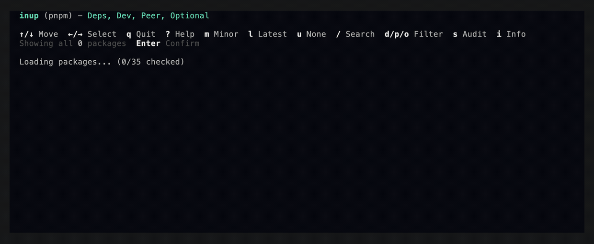

<p align="center">
  
</p>

# inup

**Dependency updates. Your call.**

[](https://www.npmjs.com/package/inup)
[](https://www.npmjs.com/package/inup)
[](https://github.com/donfear/inup/actions/workflows/ci.yml)

See what's outdated, read what changed, and pick what to upgrade. Works with **npm, pnpm, Yarn, and Bun**, and stays fast on big monorepos ([benchmarks](#speed)).

Run this in your project:

```bash
npx inup
```

Requires Node.js 22.19+. No configuration needed.



## Why inup

| | inup | npm-check-updates | taze |
| --- | :-: | :-: | :-: |
| Interactive picker | ✓ | ✓ | ✓ |
| Monorepos and workspaces | ✓ | ✓ | ✓ |
| Release-age cooldown | ✓ | ✓ | ✓ |
| Each package's changelog, inside the picker | ✓ | | |
| Vulnerability audit, with the versions that fix it | ✓ | | |
| A scheduled update PR from a GitHub Action | ✓ | | |

<sub>Other tools' features as their READMEs describe them, October 2026.</sub>

## Pick your updates

Move with `↑` / `↓`, select with `Space`, and press `Enter` to apply. Your dependency files stay untouched until you confirm. Then inup writes the selected versions and runs your package manager's install to update the lockfile.

| Want to… | Press |
| --- | --- |
| Find a package | `/` |
| Read its changelog | `i` |
| Check known vulnerabilities and available fixes | `s` |
| Select updates within your existing version ranges | `m` |
| Choose an in-range update or the latest version | `←` / `→` |

Review the diff and run your tests after upgrading.

<details>
<summary>All keyboard shortcuts</summary>

<!-- KEYS:START -->
| Key | Action |
|-----|--------|
| `↑ / k` | Move up |
| `↓ / j` | Move down |
| `g / Home` | Jump to the first package |
| `G / End` | Jump to the last package |
| `PgUp` | Move up one page |
| `PgDn` | Move down one page |
| `←` | Cycle selection left (latest → range → none) |
| `→` | Cycle selection right (none → range → latest) |
| `Space` | Toggle the current package on/off |
| `m` | Select all minor/patch updates, except peers and patched packages |
| `l` | Select all latest updates (including major), except peers and patched packages |
| `u` | Unselect all packages |
| `Enter` | Confirm selection and upgrade |
| `/` | Search packages by name |
| `d` | Toggle devDependencies |
| `p` | Toggle peerDependencies |
| `o` | Toggle optionalDependencies |
| `s` | Run the vulnerability audit |
| `v` | Show only vulnerable packages |
| `c` | Show packages held back by the release-age cooldown |
| `Esc` | Clear the active search filter |
| `i` | View package details and changelog |
| `t` | Change the color theme |
| `?` | Show this help |
| `!` | Show the performance/debug panel |
| `q` | Quit without changes |
<!-- KEYS:END -->

</details>

## One project or a whole monorepo

inup detects your package manager and finds dependencies across workspaces. Private registries use your `.npmrc`. pnpm catalog entries are updated in `pnpm-workspace.yaml`.

Global tools too: `npx inup -g` upgrades what you installed with `npm install -g` (or pnpm and Bun with `--package-manager`). Need to leave a package alone? Run `npx inup --ignore "react,react-dom"`, or save your rules in [`.inuprc`](docs/guide/configuration.md).

<!-- BENCHMARK:START -->
## Speed

On a first run, inup lists outdated dependencies up to 11× faster than npm-check-updates and up to 9× faster than taze on these repositories.

How long each tool takes, on public repositories pinned to a commit, to list every outdated dependency and to open its picker with every update loaded. Lower is better.

<picture>
  <source media="(prefers-color-scheme: dark)" srcset="docs/benchmark/speed-dark.svg">
  
</picture>

<details>
<summary>All timings</summary>

### Listing outdated dependencies

Each tool prints every outdated dependency and exits.

| First run | [expressjs/express](https://github.com/expressjs/express/tree/0dee2c52c7c873498f8ed7d8ee4ddd0a04d3ada8)<br><sub>1 package.json · 44 dependencies</sub> | [vuejs/core](https://github.com/vuejs/core/tree/65eae178383289b6a9f93505ab85017460f72395)<br><sub>22 package.json files · 69 dependencies</sub> | [TanStack/query](https://github.com/TanStack/query/tree/ce77be5e15c695df9d4d9122caf9256d334433ba)<br><sub>105 package.json files · 190 dependencies</sub> | [vendurehq/vendure](https://github.com/vendurehq/vendure/tree/1dcaf0ee504675f3462d6302c23ff9f16beb2773)<br><sub>54 package.json files · 323 dependencies</sub> | [backstage/backstage](https://github.com/backstage/backstage/tree/76b0c7a48ef737b1a46342c29269827715d70684)<br><sub>269 package.json files · 591 dependencies</sub> |
| :-- | --: | --: | --: | --: | --: |
| inup | 0.28 s | **0.61 s** | **0.79 s** | **1.54 s** | **1.46 s** |
| npm-check-updates | 0.74 s | 3.49 s | 8.77 s | 3.24 s | 10.1 s |
| taze | 0.84 s | 1.57 s | 7.29 s | 5.58 s | 10.5 s |
| syncpack | **0.25 s** | 0.97 s | 2.24 s | 4.17 s | 3.84 s |
| npm-check | 1.20 s | — | — | — | — |
| npm / pnpm / bun outdated | 0.97 s | 1.54 s | 2.44 s | 1.68 s | — |

| Repeat run | [expressjs/express](https://github.com/expressjs/express/tree/0dee2c52c7c873498f8ed7d8ee4ddd0a04d3ada8) | [vuejs/core](https://github.com/vuejs/core/tree/65eae178383289b6a9f93505ab85017460f72395) | [TanStack/query](https://github.com/TanStack/query/tree/ce77be5e15c695df9d4d9122caf9256d334433ba) | [vendurehq/vendure](https://github.com/vendurehq/vendure/tree/1dcaf0ee504675f3462d6302c23ff9f16beb2773) | [backstage/backstage](https://github.com/backstage/backstage/tree/76b0c7a48ef737b1a46342c29269827715d70684) |
| :-- | --: | --: | --: | --: | --: |
| inup | 0.23 s | 0.25 s | 0.40 s | 0.60 s | 0.95 s |
| npm-check-updates | 0.74 s | 3.28 s | 8.73 s | 3.14 s | 9.56 s |
| taze | 0.23 s | 0.54 s | 5.07 s | 2.18 s | 6.69 s |
| syncpack | **0.05 s** | **0.18 s** | **0.38 s** | 0.80 s | **0.63 s** |
| npm-check | 1.22 s | — | — | — | — |
| npm / pnpm / bun outdated | 0.75 s | 0.21 s | 3.49 s | **0.09 s** | — |

### Opening the picker

Each tool's interactive list of updates, timed until every update is loaded.

| First run | [expressjs/express](https://github.com/expressjs/express/tree/0dee2c52c7c873498f8ed7d8ee4ddd0a04d3ada8) | [vuejs/core](https://github.com/vuejs/core/tree/65eae178383289b6a9f93505ab85017460f72395) | [TanStack/query](https://github.com/TanStack/query/tree/ce77be5e15c695df9d4d9122caf9256d334433ba) | [vendurehq/vendure](https://github.com/vendurehq/vendure/tree/1dcaf0ee504675f3462d6302c23ff9f16beb2773) | [backstage/backstage](https://github.com/backstage/backstage/tree/76b0c7a48ef737b1a46342c29269827715d70684) |
| :-- | --: | --: | --: | --: | --: |
| inup | 0.39 s | **0.74 s** | **0.96 s** | **1.45 s** | **1.85 s** |
| npm-check-updates | 0.71 s | — | — | — | — |
| taze | 0.87 s | 1.42 s | 7.32 s | 5.56 s | 10.4 s |
| syncpack | **0.25 s** | 0.93 s | 2.22 s | 3.93 s | 3.66 s |
| npm-check | 1.20 s | — | — | — | — |
| pnpm / bun update -i / yarn upgrade-interactive | — | 1.53 s | 2.40 s | 1.69 s | 9.41 s |

| Repeat run | [expressjs/express](https://github.com/expressjs/express/tree/0dee2c52c7c873498f8ed7d8ee4ddd0a04d3ada8) | [vuejs/core](https://github.com/vuejs/core/tree/65eae178383289b6a9f93505ab85017460f72395) | [TanStack/query](https://github.com/TanStack/query/tree/ce77be5e15c695df9d4d9122caf9256d334433ba) | [vendurehq/vendure](https://github.com/vendurehq/vendure/tree/1dcaf0ee504675f3462d6302c23ff9f16beb2773) | [backstage/backstage](https://github.com/backstage/backstage/tree/76b0c7a48ef737b1a46342c29269827715d70684) |
| :-- | --: | --: | --: | --: | --: |
| inup | 0.31 s | 0.40 s | **0.62 s** | **0.67 s** | 1.23 s |
| npm-check-updates | 0.71 s | — | — | — | — |
| taze | **0.24 s** | 0.53 s | 5.23 s | 2.31 s | **0.63 s** |
| syncpack | 0.25 s | 0.92 s | 2.25 s | 3.94 s | 3.69 s |
| npm-check | 1.16 s | — | — | — | — |
| pnpm / bun update -i / yarn upgrade-interactive | — | **0.21 s** | 3.43 s | 1.66 s | 3.43 s |

<sub>First run: every cache the tool keeps is emptied before each run. Repeat run: caches kept. Median of 10 runs per tool on GitHub Actions ubuntu24 20261012.334.1, 4 CPUs, Node v24.21.0, 22 Oct 2026; listing timed with [hyperfine](https://github.com/sharkdp/hyperfine) 1.20.0. Pickers run in a 160×50 terminal and count as loaded at the last thing they draw or write to their cache before 5 s of quiet, so rows fetched off screen count too. inup runs with `--no-audit`: the other tools don't check for vulnerabilities, so it skips its check too. inup runs on its native (Rust) core, built from the same commit. Fastest in **bold**.</sub>

</details>

[How it's measured, tool versions and exact commands](docs/guide/benchmarks.md)
<!-- BENCHMARK:END -->

## Let a release age before you take it

A version published an hour ago is the one most likely to be a compromised release nobody has caught yet. Give releases a cooldown and inup stops offering anything younger — in the picker, in reports, and in `--apply`:

```bash
npx inup --minimum-release-age 10080   # nothing published in the last 7 days
```

Keep it in [`.inuprc`](docs/guide/configuration.md) as `minimumReleaseAge` (minutes, the same name and unit pnpm uses), with `minimumReleaseAgeExclude` for your own packages.

inup tells you what it held back rather than quietly showing you fewer updates, so a package waiting out its cooldown never looks the same as a package that is up to date.

Registries that don't publish release times are unaffected — the cooldown only acts on evidence it actually has.

## GitHub Action: one PR, kept up to date

Let inup run on a schedule. It opens a dependency-update pull request and refreshes that same PR on later runs. You review and merge when you're ready.

<details>
<summary>Add the workflow to your repo</summary>

Save this as `.github/workflows/inup.yml`:

```yaml
name: Dependency updates

on:
  schedule:
    - cron: '17 5 * * 1' # Mondays at 05:17 UTC
  workflow_dispatch:

permissions:
  contents: write
  pull-requests: write

jobs:
  upgrade:
    runs-on: ubuntu-latest
    steps:
      - uses: actions/checkout@v6
      - uses: donfear/inup@v1
        with:
          target: minor
```

In your repo's **Settings → Actions → General → Workflow permissions**, enable **Allow GitHub Actions to create and approve pull requests**.

`minor` stays within existing version ranges, following each range's operator: `^0.2.3` stays on `0.2.x` and `~1.2.3` on `1.2.x` ([full rule](docs/guide/ci.md#--apply)). Use `patch` for patch updates only, or `latest` to include major upgrades.

If you need the PR to trigger CI, pass a personal access token through the action's `token` input. See the [Action guide](docs/guide/github-action.md) for all inputs and outputs.

</details>

## Native core

inup fetches and parses registry data with a native core written in Rust: on large projects it uses about half the CPU and a quarter less memory, and the list stays responsive while packages load. It's on by default.

inup itself installs no native code. The first interactive run downloads the core for your platform (about 1.5 MB), checks it against the hash built into your copy of inup and caches it; from the next run on, inup uses it, re-checking the cached file each time. A core that doesn't match is never loaded, whichever registry served it. Scripted runs (`--json`, `--check`, `--apply`, CI) use the core once it's cached but never download it themselves, so they finish without waiting on it. Supported on macOS, Linux and Windows (x64 and arm64). If it can't be used, inup quietly falls back to the standard core.

```bash
npx inup --no-native  # standard core for this run
npx inup --native     # native core, downloading it even in a scripted run
```

To turn it off for a project, add `"native": false` to [`.inuprc`](docs/guide/configuration.md#native).

## Using it in scripts?

```bash
npx inup --check  # Exit 1 if updates exist; don't change files
npx inup --json   # Print a JSON report; don't change files
npx inup --apply  # Apply in-range updates and run install
npx inup --apply --verify "npm test"  # Keep only the upgrades your tests pass with
```

[CLI reference](docs/guide/cli.md) · [CI guide](docs/guide/ci.md) · [Troubleshooting](docs/guide/faq.md)

---

No telemetry or tracking. inup contacts your package registry for metadata and security advisories, npm for download counts, and GitHub for release notes.

[Documentation](docs/guide/README.md) · [Changelog](CHANGELOG.md) · [Report a bug](https://github.com/donfear/inup/issues) · [MIT license](LICENSE)

<details>
<summary>Tests and coverage</summary>

<!-- TEST-BADGES:START -->
[](https://github.com/donfear/inup/actions/workflows/ci.yml)
[](https://github.com/donfear/inup/actions/workflows/ci.yml)
<!-- TEST-BADGES:END -->

</details>
